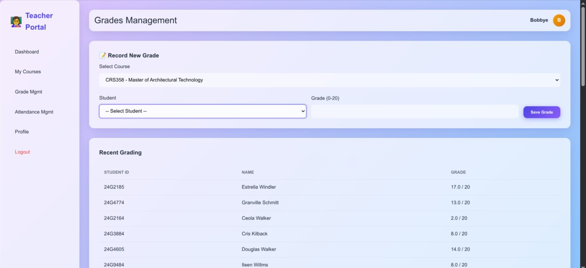
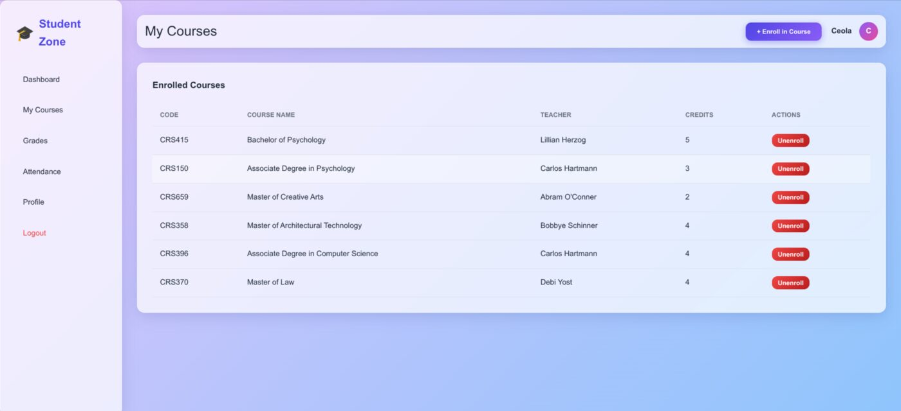
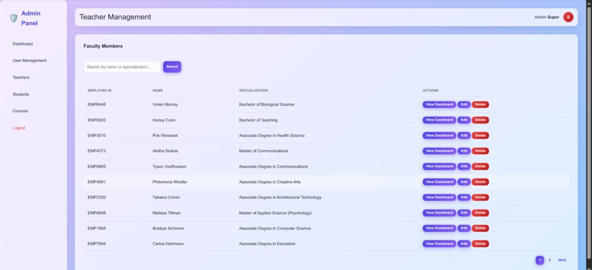
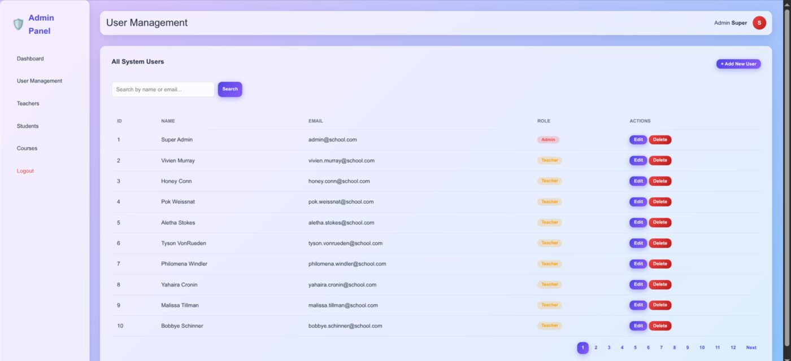
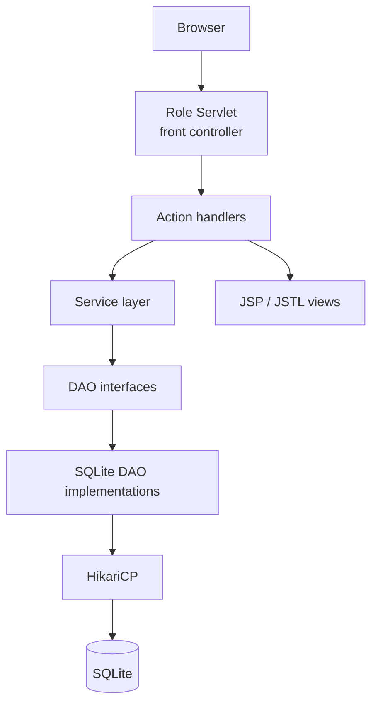

# Campus Connect

A school management system with four role-specific portals: administration,
teaching, student, and parent. Built with Java 17, Jakarta EE 10, JSP/JSTL, and
SQLite.

[](https://github.com/Zeusse-Neumbi/campus-connect/actions/workflows/ci.yml)
[](LICENSE)


## Overview

Campus Connect models the day-to-day operations of a small school: courses,
classrooms, course groups, sessions, enrollment, attendance, exams, and grades.
Each user type gets a separate portal and permission boundary instead of sharing
one generic dashboard.

| Portal | What it does |
| --- | --- |
| **Admin** | Manage users, teachers, students, parents, courses, classrooms, groups, and sessions. View KPI dashboards and audit data. |
| **Teacher** | View assigned courses and weekly sessions, record grades and attendance, and manage course groups. |
| **Student** | View enrolled courses, timetable, grades, attendance, and transcript. |
| **Parent** | View linked children's grades, attendance, schedule, and transcript. |

## Screenshots

| Teacher — grades | Student — courses |
| --- | --- |
|  |  |

| Admin — teachers | Admin — users |
| --- | --- |
|  |  |

## Architecture



- **Front controller per role.** `AdminServlet`, `TeacherServlet`,
  `StudentServlet`, and `ParentServlet` dispatch subpaths to focused
  `ActionHandler` classes.
- **Service layer.** Business rules such as grade averaging, enrollment checks,
  and timetable conflicts live in service classes, not servlets or JSPs.
- **DAO layer.** SQL stays in `dao/impl`; services depend on DAO interfaces.
- **Connection pooling.** HikariCP manages SQLite connections and enables foreign
  keys on every connection.
- **Server-rendered views.** JSP/JSTL keeps the UI simple and avoids a second
  application runtime.

## Database

The schema has 15 tables covering users and roles, students, teachers, parents,
student-parent links, courses, groups, sessions, classrooms, enrollment,
attendance, exams, and exam results. Foreign keys are enforced with
`PRAGMA foreign_keys = ON`.

The application creates the schema on first boot. When the user table is empty,
`DataSeeder` generates demo data: roughly 3,000 students, 2,000 parents, teachers,
courses, sessions, attendance, and exam results.

## Tech stack

| Layer | Technology |
| --- | --- |
| Language | Java 17 |
| Web | Jakarta Servlet 6.0, JSP 3.1, JSTL 3.0 |
| Server | Jetty 12 (Maven plugin) |
| Database | SQLite 3.45 via `sqlite-jdbc` |
| Pooling | HikariCP 5.1 |
| Password hashing | jBCrypt |
| Demo data | Datafaker |
| Tests | JUnit 5 + Mockito 5 |
| Build | Maven 3.6+ |

## Getting started

### Requirements

- JDK 17+
- Maven 3.6+

### Run locally

```bash
git clone https://github.com/Zeusse-Neumbi/campus-connect.git
cd campus-connect
mvn clean verify
mvn jetty:run
```

Open <http://localhost:9091>.

The first request initializes `school.db` and seeds demo data. To reset it, stop
the server, delete `school.db`, and start again.

### Optional public tunnel

`NgrokListener` can expose the local server for a quick review. It is disabled
unless `NGROK_AUTHTOKEN` is set:

```bash
cp .env.example .env
# add your token to .env
mvn jetty:run
```

Do not use the demo credentials or tunnel for a production deployment.

## Demo credentials

These accounts exist only in the seeded local database:

| Role | Email | Password |
| --- | --- | --- |
| Admin | `admin@school.com` | `admin123` |
| Teacher | `firstname.lastname<id>@school.com` | `password123` |
| Student | `firstname.lastname<id>@student.school.com` | `password123` |
| Parent | `firstname.lastname<id>@parent.school.com` | `password123` |

## Tests

```bash
mvn test
```

The suite contains 59 JUnit 5 tests across 14 test classes. It covers service
rules, DAO behavior, password handling, parsing, model behavior, login, and a
dashboard handler. Tests use a separate SQLite database and do not seed the full
demo dataset.

CI runs the same command on Java 17 for every push and pull request.

## Project layout

```text
src/main/java/com/example/school/
├── dao/                  # DAO interfaces and SQLite implementations
├── model/                # Domain entities
├── service/              # Business rules
├── util/                 # Seeding, parsing, password helpers
└── web/
    ├── controller/       # Role servlets
    └── handler/          # Action handlers
src/main/webapp/
├── assets/               # CSS and JavaScript
└── WEB-INF/views/        # JSP views and layout fragments
```

## Design notes

- **Role boundaries are explicit.** Each portal has its own servlet and handlers;
  a student request never reaches an admin action through a shared switch.
- **Server-side rendering is deliberate.** The project targets a simple WAR
  deployment and avoids a separate frontend build.
- **Demo data is generated, not committed.** `school.db` is ignored; the seeder
  creates a fresh dataset on first boot.
- **SQLite is a deliberate constraint.** It keeps the project self-contained for
  coursework and review. A production deployment would move to PostgreSQL or
  MySQL and add migrations.

## Limitations and next steps

- The package name is still `com.example.school`; a production fork should rename
  it.
- Demo credentials and admin impersonation are for local review only.
- The UI is server-rendered with JSP; a future version could add a REST API.
- SQLite limits concurrent writes; the DAO layer would need a different
  implementation for a multi-instance deployment.

## License

[MIT](LICENSE) © 2026 Neumbi Kemgang Zeusse
